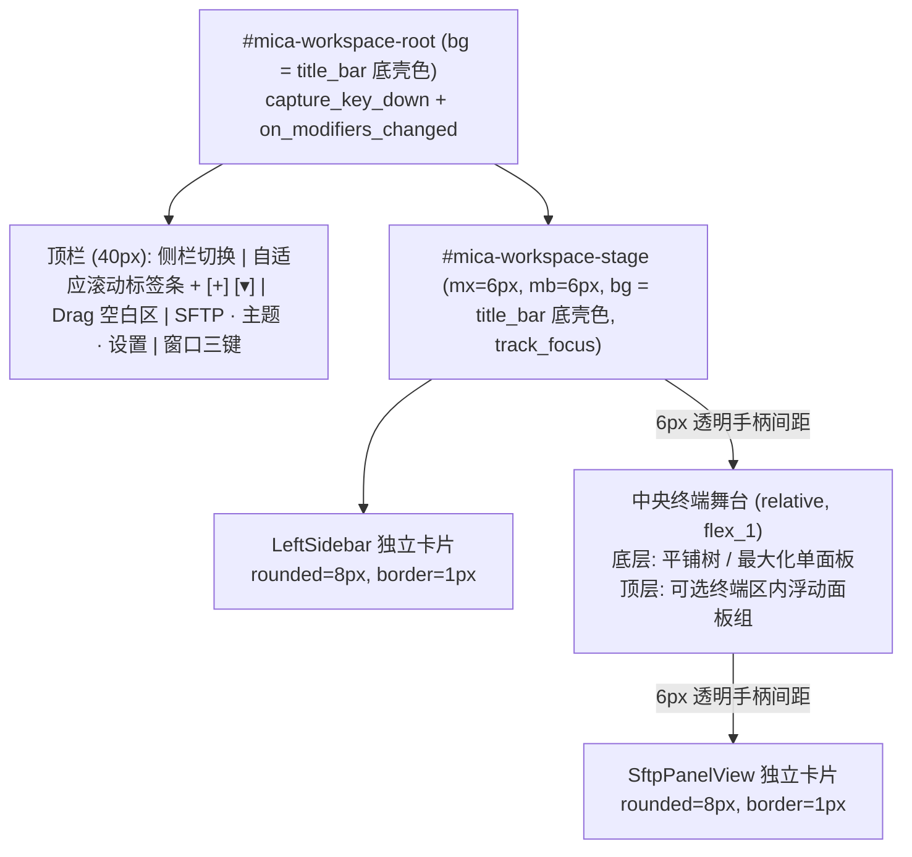

# Mica Term GPUI：对标 Rex 分屏区块化/最大化/浮动粒子边框、多标签高亮、PowerShell 动态标题与顶栏拖拽修复方案

> [!IMPORTANT]
> **文档说明**：本文档由 **Antigravity (AGY) × Codex (`gpt-6.2-astra`)** 经源码逐行排查、6 张实机参考截图像素级测量与只读交叉评审后联合产出（配套分步落地手册见 [rex-split-tab-drag-execution.md](file:///home/wwwroot/mica-term-gpui/docs/rex-split-tab-drag-execution.md)）。
> 当前阶段**未修改任何业务源码**，待审阅确认后严格按本文档与执行手册分步落地。

---

## 一、七大问题精确根因诊断（源码级还原与联合核验）

| 编号 | 用户反馈现象 | 精确源码位置 | 根因链路与 AGY × Codex 联合核验结论 |
| :---: | :--- | :--- | :--- |
| **P0** | **致命 Bug：顶部状态栏/标题栏无法拖动窗口** | [workspace.rs](file:///home/wwwroot/mica-term-gpui/src/ui/workspace.rs#L1870-L2011) [workspace.rs](file:///home/wwwroot/mica-term-gpui/src/ui/workspace.rs#L2194-L2211) [workspace.rs](file:///home/wwwroot/mica-term-gpui/src/ui/workspace.rs#L2300-L2316) [events.rs](file:///home/wwwroot/mica-term-gpui/patches/gpui-pre-windows/src/events.rs#L1015-L1049) | **两条独立故障链叠加导致拖拽彻底失效**： ① **根焦点拦截吞掉 Win32 `WM_NCLBUTTONDOWN(HTCAPTION)`**：[workspace.rs](file:///home/wwwroot/mica-term-gpui/src/ui/workspace.rs#L2311) 在包住 `title_bar` 的最外层 `mica-workspace-root` 上挂载了 `.track_focus(&self.focus_handle)`。GPUI 的 `Div::paint_mouse_listeners` 在 Bubble 阶段对未阻止默认行为的左键按下自动执行 `window.focus(...)` 并调用 **`window.prevent_default()`**。而 Windows 平台补丁 [events.rs](file:///home/wwwroot/mica-term-gpui/patches/gpui-pre-windows/src/events.rs#L1040-L1049) 将 `wparam == HTCAPTION && result.default_prevented` 判定为 `handled = true`，立即调用 `SetCapture(handle)` 并返回 `Some(0)` 拦截事件，`DefWindowProcW` 永远收不到原生标题栏拖动消息；同时提交 `27953d7` 移除了原 `TitleBar` 的 `start_window_move()` 路径，导致 Windows 下连真正的 `drag_space` 也 **100% 拖不动**。 ② **标签滚动容器默认 `width: 100%` 吞噬顶栏空白**：[workspace.rs](file:///home/wwwroot/mica-term-gpui/src/ui/workspace.rs#L1959-L1964) 调用 `.min_w_0().overflow_x_scrollbar()` 时未显式声明 `.w_auto()`，`Scrollable::render` 外层默认 `.size_full()`（`width: 100%`），导致只要打开 ≥ 1 个标签，滚动容器就吃满整行剩余宽度，把 `drag_space` 挤成右侧 `24px` 窄缝，中间 700px 视觉空白全部落入非拖拽区（Windows / Linux 双端均失拖），且 Linux 下窗口三键底部的 `6px` 细条也漏挂了拖动手势。 |
| **1** | **分屏后右上角关闭按钮与终端首行文字重叠，难以辨认**（`xev9cy.png`） | [terminal_view.rs](file:///home/wwwroot/mica-term-gpui/src/ui/terminal_view.rs#L1032-L1050) [terminal_view.rs](file:///home/wwwroot/mica-term-gpui/src/ui/terminal_view.rs#L1365-L1376) | `split_close_badge` 使用 `.absolute().occlude().top_1p5().right_3()` 直接浮在 `terminal_canvas` 之上，而画布仅留 `pad_y = 6px`，分屏本身没有独立顶部栏，导致 `×` 直接压在第 0 行右侧输出字符（如 `PREEMPT_DYN`、`.viminfo`）上。 |
| **2** | **分屏缺乏区块划分与间距；分屏入口误放主顶栏；单面板不该有关闭键；缺少选中常显/未选中悬停显示菜单**（`xfzd5r.png`） | [workspace.rs](file:///home/wwwroot/mica-term-gpui/src/ui/workspace.rs#L144-L168) [workspace.rs](file:///home/wwwroot/mica-term-gpui/src/ui/workspace.rs#L2023-L2052) [workspace.rs](file:///home/wwwroot/mica-term-gpui/src/ui/workspace.rs#L2318-L2329) | ① 外层把左栏、中央区与 SFTP 合包在同一个 `rounded(8).border_1().bg(background)` 大盒子里，内部分屏仅靠 `1px` 分隔线紧贴切分，无独立圆角区块与底壳间距； ② 水平/垂直分屏按钮放在窗口主顶栏右侧，而非终端面板内部； ③ 面板没有顶部操作栏，也没有按“选中分屏常显、未选中分屏鼠标移入显示、单分屏隐藏关闭按钮”的显隐状态机；且现有 `split_active_tab` 只以 `active_pane` 为目标，若悬停点击未选中分屏的按钮会分错目标。 |
| **3** | **缺少 Rex 标志性的分屏「最大化 / 还原」与「终端区域内浮动 + 粒子感边框」**（`xidqwc.png`） | [workspace.rs](file:///home/wwwroot/mica-term-gpui/src/ui/workspace.rs#L55-L207) | `WorkspaceTab` 仅有平铺树 `PaneLayoutNode`，不支持非破坏性单面板最大化/还原，也不支持将分屏抽离为终端工作区内部可自由拖拽、边缘缩放、折叠收起、一键停靠回平铺树的浮动终端小窗及微光粒子边框。此外 Codex 核查发现：`ResizablePanelGroup` 默认用 `window.use_keyed_state` 保存拖拽比例，一旦最大化卸载平铺树或切换标签，原有不等比分屏比例就会丢失，必须在 `Split` 节点显式持有 `Entity<ResizableState>`。 |
| **4** | **新建标签 `+` 按钮被顶到最右侧，未紧跟最后一个标签**（`xjjovf.png`） | [workspace.rs](file:///home/wwwroot/mica-term-gpui/src/ui/workspace.rs#L1958-L2010) | 与 P0 第②点同源：`h_flex().min_w_0().overflow_x_scrollbar()` 缺少 `.w_auto()`，`Scrollable` 外层 `width: 100%` 强行撑满剩余空间，把 `+` 和下拉箭头推到了最右侧工具区旁，违背了 Rex `xjjovf.png`（`+` 紧贴末个标签右侧约 `6px`）的直觉布局。 |
| **5** | **多标签选中态高亮不足（深色模式甚至变暗凹陷），间距与未选中分隔线未对齐 Rex**（`xjjlzf.png`） | [theme.rs](file:///home/wwwroot/mica-term-gpui/src/ui/theme.rs#L218) [workspace.rs](file:///home/wwwroot/mica-term-gpui/src/ui/workspace.rs#L1695-L1830) | [theme.rs](file:///home/wwwroot/mica-term-gpui/src/ui/theme.rs#L218) 将 `theme.tab_active = theme.background`：在默认深色主题 `Rex Obsidian` 下顶栏为 `#1E2025`，`background` 却是更暗的 `#12141A`，导致活动标签看起来像凹陷黑坑而非高亮胶囊；浅色模式下 `#FAFAFC` 与 `#ECEEF2` 反差也偏弱；且相邻未选中标签之间缺少 Rex 的 `1×14px` 竖向细分隔线。 |
| **6** | **本地 Windows PowerShell 标签名显示原始长路径，未统一为 `powershell ~` 及 `12字符+...` 实时更新**（`xlwapm.png`） | [session.rs](file:///home/wwwroot/mica-term-gpui/src/terminal/session.rs#L401-L417) [pty_backend.rs](file:///home/wwwroot/mica-term-gpui/src/terminal/pty_backend.rs#L50-L79) [semantic.rs](file:///home/wwwroot/mica-term-gpui/src/terminal/semantic.rs#L769-L806) [engine.rs](file:///home/wwwroot/mica-term-gpui/src/terminal/engine.rs#L1816-L1862) | ① ConPTY 启动 `powershell.exe` / `pwsh.exe` 时发出的窗口标题（如 `C:\Windows\System32\...\powershell.exe`）被 [session.rs](file:///home/wwwroot/mica-term-gpui/src/terminal/session.rs#L402) 原样覆盖为标签名； ② PowerShell 默认不发 `OSC 7`，而 `extract_cwd_from_prompt_line` 仅支持 Unix 路径，明确忽略了 `PS C:\Users\...>`（见 [semantic.rs](file:///home/wwwroot/mica-term-gpui/src/terminal/semantic.rs#L1394) 负例测试）； ③ `osc_tail` 目前用 `String` 逐包 `from_utf8_lossy`，中文目录名跨 PTY 读包会损坏 UTF-8 字节；且本地 `CurrentDirChanged` 误写入 `remote_cwd` 触发 SFTP 事件，标签名分散在 `workspace.rs` 5 处手工赋值。 |

---

## 二、核心架构与视觉交互方案（像素级对标 Superlogical Rex）

### 2.1 顶栏窗口拖拽修复：平台原生非客户区与客户端手势各司其职

1. **下移根级焦点追踪（消除 `HTCAPTION` 拦截根因）**：
   - 保持 `#mica-workspace-root` 上的 `.capture_key_down` 与 `.on_modifiers_changed` 不变（确保全局快捷键与双分屏 `Ctrl+Hover` 链接光标正常）；
   - 将 `.track_focus(&self.focus_handle)` 下移至 `title_bar` 下方的 `#mica-workspace-stage` 容器。如此一来，点击顶栏空白不再触发根容器的 `window.focus` + `window.prevent_default()`，既不会抢走当前活动终端的输入焦点，也不会令 Win32 `handle_nc_mouse_down_msg` 吞掉 `WM_NCLBUTTONDOWN(HTCAPTION)`。
2. **精确划分拖拽命中区（严守 GPUI `window_control_hitboxes` 顺序契约）**：
   - GPUI 按注册顺序匹配首个命中的 `WindowControlArea`，因此**绝不在包裹标签与窗口三键的祖先容器上整片标记 `Drag`**（否则会抢占最大化按钮的 `HTMAXBUTTON`，破坏 Windows 11 悬停分屏布局 Snap Layouts）。
   - 抽取统一的空白拖拽绑定辅助函数，同时挂载到 **主顶栏弹性空白区 `drag_space`**（`flex_1().min_w(px(32.0)).h_full()`）与 **窗口三键底部的 `6px` 呼吸细条**：
     - **Windows**：标记 `.window_control_area(WindowControlArea::Drag)`，按下、拖动、双击最大化/还原、最大化拖下还原、右键系统菜单及顶部边缘 DPI 缩放全部交由 Win32 原生非客户区处理，不叠加冗余手工 `SC_MOVE` / `zoom_window()`。
     - **Linux 客户端装饰（Wayland / X11）**：因后端未实现 `on_hit_test_window_control`，在这两块空白区统一挂载完整手势状态机（左键按下抑制文本选区并记录起点，首次移动调 `window.start_window_move()`，原地双击调 `window.zoom_window()`，右键调 `window.show_window_menu()`，配对处理越界移动、`on_mouse_up`、`on_mouse_down_out` 与窗口失焦清理）。

---

### 2.2 标签栏紧凑滚动、`+` 紧随末标签、活动胶囊高亮与分隔线（对标 `xjjovf.png` & `xjjlzf.png`）

1. **`.w_auto()` 紧凑自适应滚动 + 新建按钮紧贴最后一个标签**：
   - 经核对 `gpui-component 0.10.0`（`scrollable.rs:198`）与 `taffy 0.15.1`（`flexbox.rs:782, 1559`），给标签容器声明 **`h_flex().w_auto().min_w_0().overflow_x_scrollbar()`** 后：
     - 当标签较少、未占满顶栏时，滚动容器外层宽度为 `auto`，精确包裹所有标签总宽；不可压缩的新建按钮组（`+` 新建本地终端 + `▾` 新建菜单）紧贴在最后一个标签右侧（间距 `6px`，与 `xjjovf.png` 实测中心偏移 `16.5px` 一致），右侧全部剩余宽度归属 `drag_space` 可自由拖动窗口；
     - 当标签增多超出可用宽度时，`min_w_0()` + 默认 `flex_shrink: 1` 自动将标签条压缩在「左栏开关」与「`+` 按钮组 + 最小 `32px` 拖拽区 + 右侧工具栏」之间，开启平滑横向滚轮/触控板滚动；新建或切换标签时自动滚入可视区。
2. **终端标签专属高亮表面与无抖动未选中分隔线**：
   - 不直接篡改侧栏分段控件与弹窗共用的 `theme.tab_active`，而是在 [theme.rs](file:///home/wwwroot/mica-term-gpui/src/ui/theme.rs) 提供经全量 54 款主题对比度校验（前景对比度 `>= 4.5:1`）的终端活动标签配色函数：
     - **浅色模式**：纯白明亮悬浮胶囊（如 `#FFFFFF` 衬于 `#ECEEF2` 底壳之上）+ `1px` 细腻描边 + 轻柔底影；
     - **深色模式**：基于实际 `title_bar` 向亮端适度提亮的悬浮胶囊（彻底消除 `#12141A` 比 `#1E2025` 更黑的凹陷感）+ 清晰微高光描边；
     - **文字与内边距**：顶栏高 `40px`（Windows 三键保持顶对齐 `46×32` + 底部 `6px` 拖拽净空，总高同步为 `40px`）；标签高 `30px`、`rounded(px(8.0))`、`pl(px(10.0))`、`pr(px(8.0))`、内部元素间距 `gap(px(7.0))`；左侧配备 `18×18px` 圆角终端/服务器徽章，活动态字重 `FontWeight::MEDIUM` / `SEMIBOLD`。
   - **未选中标签竖向分隔线（对标 `xjjlzf.png`）**：在每一对相邻标签 `(i, i + 1)` 之间固定预留 `1px × 14px` 槽位——**仅当左右两个标签均未激活时**着色为 `cx.theme().border`，紧邻活动标签两侧保持透明，切换活动标签时整排标签 **零像素横跳**。

---

### 2.3 分屏独立区块卡片、`6px` 底壳间距、内嵌 `28px` 顶栏与精确目标路由（对标 `xfzd5r.png`）

1. **单一卡片边框 + `6px` 底壳间距 + 透明 Idle 分隔手柄**：
   - 将 [workspace.rs](file:///home/wwwroot/mica-term-gpui/src/ui/workspace.rs#L2318-L2329) 原先整块包裹左中右的单一白底描边容器改为透明底壳容器（保留左/右/下 `6px` 窗口呼吸外距）。
   - `LeftSidebar`、`WelcomeView`、每个终端分屏卡片（`TerminalPaneView`）与 `SftpPanelView` **各自独立绘制一次 `rounded(px(8.0))` + `1px` 外框**（活动分屏在多面板态可使用轻微提亮的主色混合描边以强化区块归属，绝不出现 2px 叠边）。
   - 在每个水平/垂直 `ResizablePanelGroup` 相邻面板交界处两侧各留 `3px`（合为实测 **`6px` 底壳间距**，仅作用于相邻内侧边缘，嵌套分屏绝不累加双倍留白）。
   - 自定义工作区与分屏 `with_handle_appearance`：**`Idle` 态必须返回 `Some(透明空元素)`**（注：返回 `None` 会回退为 `gpui-base` 默认 `1px` 实线穿破间距！），仅在 `Hovered / Pressed / Dragging` 时在 `6px` 通道正中浮现 `3px` 圆角拖拽胶囊指示条，完整保留 `9px` 跨缝拖拽命中带。
2. **移除主顶栏分屏键，终端卡片内置固定 `28px` 顶部栏（零文字重叠）**：
   - 移除窗口主顶栏右侧的 `title-split-h` 与 `title-split-v`。
   - `TerminalPaneView` 改为纵向两段式卡片：
     - **上方 `28px` 固定面板顶栏**（与终端画布共享 `snapshot.background` 底色，浑然一体）：
       - 左侧：`>_`（本地 Shell）或服务器图标（SSH，带连接状态色）+ `session.pane_title()` 完整标题（过窄时自动省略号截断）。
       - 右侧动作按钮栏：**仅当 `is_active_pane || is_card_hovered || is_floating || is_maximized` 时显示**（悬停状态监听挂在整张 `TerminalPaneView` 卡片外层，鼠标从终端正文移向右上角按钮时平滑常驻不闪烁；未选中且未悬停的面板如 `xfzd5r.png` 左上角一样干净无按钮）：
         - **单面板态（当前标签总面板数 `== 1`）**：**仅显示 `向右分屏 (Columns2)`、`向下分屏 (Rows2)`**，**不渲染关闭按钮 `×`、浮动按钮与最大化按钮**（严格落实“如果只有一个终端分屏 关闭 按钮不应该有了”）。
         - **多面板态（总面板数 `> 1`）**：依次显示 `向右分屏`、`向下分屏`、`浮动 / 停靠还原 (PictureInPicture2 / Dock)`、`最大化 / 还原 (Maximize2 / Minimize2)`、（浮动态专属）`折叠 / 展开浮窗 (CircleMinus / CirclePlus)`、`关闭当前分屏 (X)`；当窄分屏宽度 `< 190px` 时自动将次要操作收入紧凑 `⋯` 菜单，确保关闭/还原始终可点。
     - **下方 `relative().flex_1().min_h_0().min_w_0()` 终端正文区**：承载 `terminal_canvas`、右上角搜索条 `search_bar` 与连接状态遮罩层 `phase_overlay`。由于顶栏占据独立 `28px` 布局高度，第 0 行终端文字、PTY 行列计算、鼠标选区与 IME 候选框坐标天然下移，**彻底根绝右上角按钮压字问题**。
3. **点击哪个分屏的操作按钮，就精确作用于哪个分屏**：
   - 扩展 `TerminalPaneEvent`，所有分屏/浮动/最大化/关闭动作均由发出事件的 `pane` 实体自身驱动（修复旧代码始终读取 `active_pane` 导致悬停非活动 SSH 面板点分屏却克隆了活动本地面板并插错位置的缺陷），并在入口处统一前置检查单标签 6 面板上限（超限时在创建 PTY/SSH 会话前直接提示返回）。

---

### 2.4 分屏「最大化 / 还原」、「终端区域内浮动」与微光粒子边框（对标 `xidqwc.png`）

#### （1）`WorkspaceTab` 单一事实源状态模型与比例持久化
- `root: PaneLayoutNode`（非空平铺树；`Split` 节点内直接持有 `Entity<ResizableState>` 并传入 `.with_state(&state)`，增删子面板时同步槽位，确保手动拖出的不等比分屏在「最大化 $\rightarrow$ 还原」或「跨标签切换」后 **100% 原样恢复比例**）。
- `floating: Vec<FloatingPaneEntry>`（按 Z 轴层序排列的终端区内浮动面板，保存基于中央终端舞台归一化的位置尺寸矩形与 `collapsed: bool` 折叠态）。
- `active_pane: Entity<TerminalPaneView>`（当前键盘焦点所属面板）与 `maximized_pane: Option<Entity<TerminalPaneView>>`（可选非破坏性最大化目标）。

#### （2）全场景状态转换确定性闭环表

| 触发操作 | 确定性状态演进结果 |
| :--- | :--- |
| **平铺 `[A, B]` 中对 `B` 点击「浮动」** | `B` 从平铺树移入 `floating` 顶层，初始定位于中央终端舞台右下象限（宽约舞台 `52%`、高约 `54%`，带最小/最大像素夹紧）；`A` 自动铺满整个底层终端舞台；总面板数仍为 2。 |
| **上述状态下关闭底层唯一平铺面板 `A`** | 同一次状态更新中将最前序浮动面板 `B` 自动展开并提升为唯一平铺根节点 `Leaf(B)`，清理浮动/最大化状态并聚焦 `B`，绝不误关整个标签。 |
| **上述状态下关闭浮动面板 `B`** | `A` 恢复为标签内唯一单面板，其右上角自动隐藏关闭、浮动与最大化按钮。 |
| **对任意面板 `P` 点击「最大化 / 还原」** | 置 `maximized_pane = Some(P)`（若 `P` 原为折叠浮窗则临时展开显示），中央舞台**仅渲染 `P` 一份实例**（防止同一会话双实例抢改 PTY 尺寸或错乱 IME 坐标）；再次点击还原后恢复原平铺比例与浮窗位置/折叠态。 |
| **在最大化或浮动面板 `P` 上点击「向右/向下分屏」** | 自动解除最大化，若 `P` 处于浮动态则先按锚点停靠回平铺树（原邻居仍在则紧邻原方位恢复，否则停靠至末尾平铺叶子旁），随后紧邻 `P` 插入新分屏并聚焦新面板。 |
| **浮动面板交互（拖拽 / 缩放 / `⊖` 折叠）** | 在左右侧栏之间的**中央终端舞台**坐标系内：拖拽 `28px` 顶栏空白自由移动，拖拽四边与四角热区自由缩放，点击 `⊖` 收起为紧凑悬浮标题条（再点展开）；窗口缩放或侧栏开合时统一经过边界夹紧函数，保证浮窗永远不会跑出终端区域外。 |

#### （3）浮动面板微光粒子特效边框（零后台帧率开销）
- **静态高质感基底**：为浮动卡片挂载双层 `BoxShadow`（内圈紧贴锐利深影锚定边界 + 外圈柔和环境散射光晕）与 `1px` 主题强调色微光描边。
- **动态星尘粒子环绕层（`FloatingBorderParticles`）**：在浮窗外围铺设一层不拦截鼠标事件的轻量独立装饰视图（`HitboxBehavior::Normal`），通过纯数学确定性相位沿圆角矩形周长轨迹绘制约 24–28 颗低透明度柔光微粒（核心亮点 + 外层柔光圈，采用主题 `primary` / `cyan` 渐变呼吸色）。
- **严格性能护栏**：
  1. 动画帧请求 `window.request_animation_frame()` **仅刷新外圈粒子装饰视图本身**，绝不触发内层 `TerminalPaneView` 重算 `render_snapshot` 终端网格快照；
  2. **仅当「当前标签激活 + 浮窗可见且未被其他最大化面板遮挡 + 主窗口处于前台激活态 + 系统未开启 `reduce_motion`」四项条件同时满足时**才请求下一帧；一旦切标签、最小化、窗口失焦或停靠收回，后台动画帧开销严格降为 **0 FPS**。

---

### 2.5 本地 Windows PowerShell（及本地 Shell）实时标题与 `12字符+...` 规则（对标 `xlwapm.png`）

1. **启动期精确采集 Shell 身份与初始目录**：
   - 升级 [pty_backend.rs](file:///home/wwwroot/mica-term-gpui/src/terminal/pty_backend.rs#L34) `LocalPtyBackend::spawn` 返回 `SpawnedLocalPty { pty, shell_name, initial_cwd, home_dir }`：
     - 将 `pwsh.exe`、`powershell.exe`、`pwsh`、`powershell` 统一归一为 **`"powershell"`**，`cmd.exe` 归一为 `"cmd"`，`bash` / `zsh` / `fish` / `sh` 取小写名；
     - **仅当 `cmd.cwd(...)` 实际设置了有效目录时**才将 `initial_cwd` 设为该目录（不盲猜假路径），重连时清空旧目录缓存。
2. **多源可信实时目录追踪 + 跨包 UTF-8 / 旧提示符防护**：
   - **修复跨包中文路径乱码**：将 [engine.rs](file:///home/wwwroot/mica-term-gpui/src/terminal/engine.rs#L209) 的 `osc_tail: String` 改为原始字节缓冲 `osc_tail: Vec<u8>`，仅在完整匹配终止符 `BEL (\x07)` 或 `ST (\x1b\\)` 后执行一次 UTF-8 解码，彻底杜绝中文目录名跨两次 PTY 读取被拆包损坏。
   - **扩展协议与 Windows 提示符提取**：
     - `scan_osc_sequences` 新增支持 Windows Terminal / PowerShell 通用的 `OSC 9;9`（剥离外层引号）并修复 `parse_osc7_file_uri` 对 Windows 本地 `file:///C:/...`（转为 `C:\...`）及 UNC `file://server/share`（转为 `\\server\share`）的解码，同时保持 Unix/SSH `file://host/var/log -> /var/log` 语义不变；
     - `extract_cwd_from_prompt_line` 按会话路径风格支持提取光标所在**空闲提示符行**的 Windows 文件系统路径（如 `PS C:\Users\L> `、`PS C:\Users\Administrator> `、`D:\work> `），严格排除 `ALT_SCREEN` 与非文件系统 Provider（如 `PS HKLM:\>`、`PS Env:\>`）；
     - **跨包优先级防回退**：记录上一次采信的空闲提示符快照，仅当空闲提示符行实际新出现或发生变化时才产出提示符目录，防止 `OSC 7 / 9;9` 刚更新目录后下一包纯光标/颜色控制序列用屏幕残留旧提示符把目录刷回旧值；
     - **屏蔽原始进程名窗口标题污染**：本地会话不再把 ConPTY 启动发出的 `C:\Windows\...\powershell.exe` 或 `Windows PowerShell` 直接覆盖为会话标题；同时将本地 `local_cwd` 与远端 `remote_cwd` 彻底解耦（本地目录变更只驱动标题刷新，仅 SSH 目录变更发 `RemoteCwdChanged` 驱动 SFTP 跟随）。
3. **单一事实源标题派生规则（消除 5 处重复手工赋值）**：
   - 删除 `WorkspaceTab.title` 的多处手工同步，统一由 `TerminalSessionEntity` 提供 **`pane_title()`（分屏内顶栏完整标题）** 与 **`tab_title()`（窗口顶栏标签短标题）**：
     - SSH 会话保持用户配置的主机名称；
     - 本地 Shell 会话对 `local_cwd` 与 `local_home_dir` 执行规范化比对（Windows 忽略大小写与非盘根/非 UNC 根末尾斜杠，保留盘根 `C:\` 与原始显示大小写）：

| 当前本地目录状态（示例：`home = C:\Users\L`） | 分屏内顶栏 `pane_title()` | 顶部标签栏 `tab_title()`（路径按 `char` 计 `>12` 截前 12 + `...`） |
| :--- | :--- | :--- |
| 等于用户主目录（`C:\Users\L` 或 `c:\users\l\`） | **`powershell ~`** | **`powershell ~`** |
| 短路径（`<= 12` 字符，如 `C:\Users`，8 字符） | **`powershell C:\Users`** | **`powershell C:\Users`** |
| 长路径（`> 12` 字符，如 `C:\Users\Administrator`，22 字符） | **`powershell C:\Users\Administrator`** | **`powershell C:\Users\Adm...`**（精确前 12 字符 + `...`，与 `xlwapm.png` 完全一致） |
| 含中文长路径（如 `D:\项目源码\云母终端工作区测试`，15 字符） | **`powershell D:\项目源码\云母终端工作区测试`** | **`powershell D:\项目源码\云母终端...`**（按 Unicode `char` 计 12 字符，绝不切半汉字） |

---

## 三、反过度防御与工程质量约束

1. **单一事实源**：会话标题仅在 `TerminalSessionEntity` 一处格式化；分屏比例仅在 `PaneLayoutNode::Split` 的 `Entity<ResizableState>` 一处保存；浮窗矩形边界约束仅在 `FloatingPaneEntry::clamp_to_stage` 一处计算。
2. **零冗余抽象与零投机兜底**：复用 `gpui_kit` 现有 `h_resizable / v_resizable / ResizableState / ScrollableElement / WindowControlArea`；不新增未要求的持久化配置开关；不在 Windows 上叠放两套互相打架的窗口拖动逻辑；不把未知窗口标题猜测性地当作目录。
3. **严格可验证性**：每一项改动均配套确定性单元测试或 GPUI Headless 布局/命中集成测试，并经 Linux 原生 `cargo test` 与 Windows 64 位交叉编译构建双重验收。

---

## 四、实施阶段总览（详见配套执行手册）

| 阶段 | 核心交付模块 | 涉及文件 |
| :---: | :--- | :--- |
| **阶段 1** | **顶栏窗口拖拽修复 + 标签栏 `.w_auto()` 紧随 `+` + 多标签高亮与竖向分隔线** | [workspace.rs](file:///home/wwwroot/mica-term-gpui/src/ui/workspace.rs)、[theme.rs](file:///home/wwwroot/mica-term-gpui/src/ui/theme.rs) |
| **阶段 2** | **本地 Shell / PowerShell 身份识别、UTF-8 安全多源 CWD 实时追踪与 `powershell ~` / `12字符+...` 标题** | [pty_backend.rs](file:///home/wwwroot/mica-term-gpui/src/terminal/pty_backend.rs)、[semantic.rs](file:///home/wwwroot/mica-term-gpui/src/terminal/semantic.rs)、[engine.rs](file:///home/wwwroot/mica-term-gpui/src/terminal/engine.rs)、[session.rs](file:///home/wwwroot/mica-term-gpui/src/terminal/session.rs) |
| **阶段 3** | **分屏独立圆角卡片、`6px` 透明手柄间距、内嵌 `28px` 悬停/激活顶栏与精确目标分屏** | [terminal_view.rs](file:///home/wwwroot/mica-term-gpui/src/ui/terminal_view.rs)、[workspace.rs](file:///home/wwwroot/mica-term-gpui/src/ui/workspace.rs)、[sidebar.rs](file:///home/wwwroot/mica-term-gpui/src/ui/sidebar.rs)、[sftp_panel.rs](file:///home/wwwroot/mica-term-gpui/src/ui/sftp_panel.rs)、[welcome_view.rs](file:///home/wwwroot/mica-term-gpui/src/ui/welcome_view.rs) |
| **阶段 4** | **分屏比例保留最大化/还原、终端区内可拖拽缩放折叠浮动面板与零后台开销粒子边框** | [workspace.rs](file:///home/wwwroot/mica-term-gpui/src/ui/workspace.rs)、[terminal_view.rs](file:///home/wwwroot/mica-term-gpui/src/ui/terminal_view.rs)、`src/ui/floating_pane.rs`（轻量浮窗框与粒子装饰组件） |
| **阶段 5** | **全量单测、Headless 布局与对比度集成测试及双平台编译验收** | [tests/settings_ui.rs](file:///home/wwwroot/mica-term-gpui/tests/settings_ui.rs) 及各模块 `#[cfg(test)]` |
