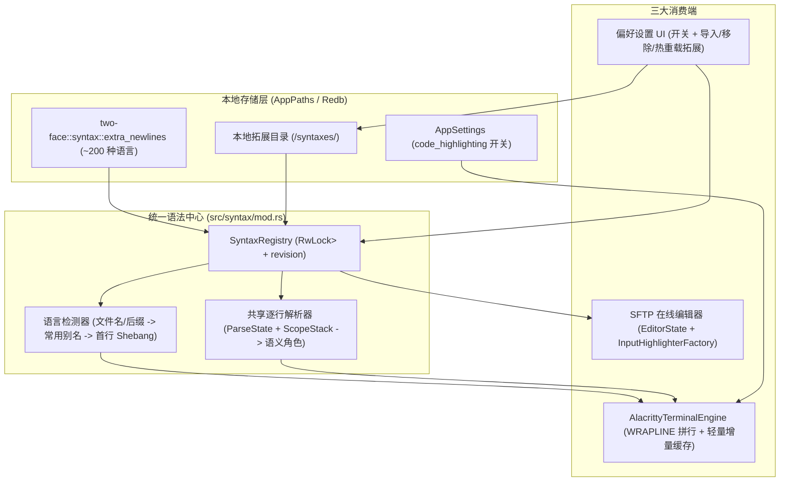
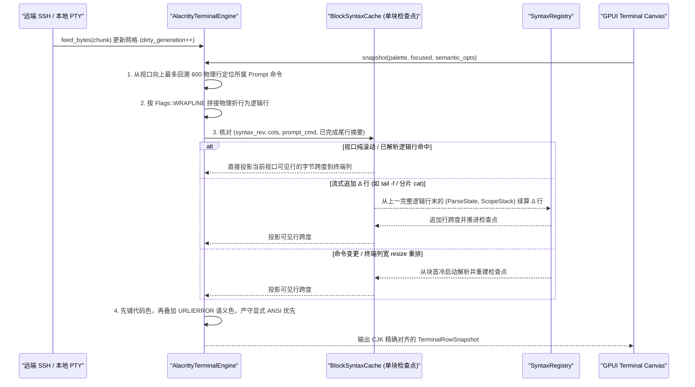

# Mica Term 多语言语法高亮、拓展加载与编辑器联动方案

> [!IMPORTANT]
> **核心原则：远端服务器 100% 零侵入，客户端架构精炼克制（KISS）。** 所有命令识别、语法作用域解析与 GPU 着色全部在本地客户端完成，远端无需安装 `bat`、无需修改 `.bashrc`、无需配置 OSC 133。

---

## 1. 建设目标与范围

围绕客户端统一的一套底层语法引擎（**`syntect 5.3` + `two-face 0.4.5`**）打通三大场景：

1. **终端命令输出实时多语言高亮**：在终端执行 `cat` / `head` / `tail` / `sed` / `diff` 等命令时，自动识别语言并对纯文本输出进行语法着色（内置约 200 种主流语言，偏好设置可独立一键开关）。
2. **本地语法拓展中心**：在应用数据目录提供 `syntaxes/` 拓展目录，原生支持导入与热重载 `.sublime-syntax` 语法文件（与 `bat` / Sublime 生态同源），并对常见简版 `.tmLanguage.json` 提供轻量转换兼容（不支持的特性直接友好提示，不做重型编译器）。
3. **右侧 SFTP「在线编辑文本」联动升级**：将 SFTP 文本编辑弹窗从普通 `Textarea` 升级为 `gpui_kit::component::input::{Editor, EditorState}` 多语言代码编辑器（带行号、大括号折叠、页内搜索、语言自动识别与手动切换，并共享自定义语法拓展库）。

---

## 2. 总体架构设计

### 核心模块与职责划分

| 模块 / 文件 | 职责说明 |
| :--- | :--- |
| [Cargo.toml](file:///home/wwwroot/mica-term-gpui/Cargo.toml) | 直接引入 `syntect = { version = "5.3", default-features = false, features = ["yaml-load", "regex-fancy"] }` 与 `two-face = { version = "0.4.5", default-features = false, features = ["syntect-fancy"] }`（不重复开启 `gpui-kit/syntect`，避免编译两份内置语法静态表） |
| `src/syntax/mod.rs` *(新增)* | 封装共享 `SyntaxRegistry`、`.sublime-syntax`（及简版 `.tmLanguage.json`）加载、语言查找、TextMate Scope 到主题角色名映射，以及 `EditorState` 的 `InputHighlighter` 实现 |
| [store.rs](file:///home/wwwroot/mica-term-gpui/src/storage/store.rs) | `AppPaths` 新增 `syntaxes_dir`（`root_dir.join("syntaxes")`），首次导入或打开目录时按需创建 |
| [models.rs](file:///home/wwwroot/mica-term-gpui/src/domain/models.rs) | `AppSettings` 新增 `#[serde(default = "default_true")] pub code_highlighting: bool`，兼容旧版配置 |
| [colors.rs](file:///home/wwwroot/mica-term-gpui/src/terminal/colors.rs) | 新增终端 `CodeTokenRole`（`Keyword`、`String`、`Comment`、`Function`、`Type`、`Number`、`Constant`、`Variable`、`Operator`、`Inserted`、`Deleted`）深浅色配色 |
| [semantic.rs](file:///home/wwwroot/mica-term-gpui/src/terminal/semantic.rs) | 新增 `SemanticOptions::code_highlighting` 及命令行目标文件/格式提取器（识别 `cat` / `head` / `tail` / `sed` / `diff` / `-o yaml\|json` 等） |
| [engine.rs](file:///home/wwwroot/mica-term-gpui/src/terminal/engine.rs) | 实现跨视口 Prompt 回溯、`Flags::WRAPLINE` 折行拼接、单块轻量增量缓存 `BlockSyntaxCache` 与单元格叠色（顺带修复现有渲染循环 `WIDE_CHAR_SPACER` 的 `intersects` 判定） |
| [modals.rs](file:///home/wwwroot/mica-term-gpui/src/ui/modals.rs) & [sftp_panel.rs](file:///home/wwwroot/mica-term-gpui/src/ui/sftp_panel.rs) | SFTP 弹窗升级为 `Editor` + `EditorState`；偏好设置新增代码高亮开关与语法拓展导入/重载/移除卡片 |
| [workspace.rs](file:///home/wwwroot/mica-term-gpui/src/ui/workspace.rs) | 初始化 `SyntaxRegistry`，通过 `PanePreferences` 同步设置开关，响应语法拓展热重载并通知分屏重绘 |

---

## 3. 终端实时流式解析与渲染方案（核心实时方案）

### 3.1 跨视口命令起点定位（单一直接路径）
- 视口第 `r` 行对应网格 `Line(r as i32 - display_offset as i32)`，可读历史下界为 `Line(-(history_size as i32))`。
- 因为语法高亮必须读取命令文本（如 `cat deploy.sh`）来判定语言，统一直接从当前视口顶部向上最多回溯 **`MAX_BLOCK_LOOKBACK_LINES = 600`** 个物理行，调用 `detect_prompt_command_byte_offset` 找到最近的完整命令起点（含折行命令）；视口内遇到下一个 Prompt（无论是否带命令）即结束当前块。不与 `Osc133Record` 做双轨对账，保持逻辑单一可靠。

### 3.2 物理折行拼接、尾空格裁剪与 CJK 列映射
按 **「物理行建图 $\rightarrow$ 逻辑行解析 $\rightarrow$ 字节区间回投物理列」** 顺序处理，确保中文双宽字符、组合字符与窄屏软折行零偏移：
1. **软折行识别与双宽占位修复**：检查网格每行末格 `Flags::WRAPLINE` 将连续软折行拼成一条逻辑行。同时将 [engine.rs](file:///home/wwwroot/mica-term-gpui/src/terminal/engine.rs#L513) 渲染循环中的 `flags.contains(WIDE_CHAR_SPACER | LEADING_WIDE_CHAR_SPACER)` 修正为与 `row_text_cells` 一致的 `.intersects(...)`，避免行尾中文折行残留前导占位格。
2. **保留软折点空格，仅裁逻辑末段填充**：软折行中间片段保留全部字节（尤其是恰好落在折点前的空格），只在整条逻辑行的最后一个物理段上 `trim_end_matches(' ')` 去除终端右侧空白填充，并为已结束的逻辑行补 `\n` 喂给 `extra_newlines()` 语法集；正在流式输出的活动尾行只试算当前文本，不提交进检查点。
3. **精确字节回投**：记录每个物理片段在逻辑行中的 UTF-8 字节区间 `[base, base + len)`。解析出的 Token 字节范围 `[s, e)` 与各片段求交后减去 `base`，直接调用该物理行的 `RowTextMap::byte_range_to_cols` 转为左闭右开列区间（例如 4 列宽首行 `中a ` `[0,5)` + 次行 `e\u{301}界` `[5,11)`，跨行 Token `[3,11)` 精确映射为首行列 `[2,4)` 与次行列 `[0,3)`）。

### 3.3 零误伤双层语言识别
仅对明确的文件输出或结构化格式着色，保证 `ls`、`ps`、`top`、`df` 等日常输出不受干扰：
1. **命令行线索**：剥离简单前缀（`sudo`、`env VAR=1`、`time`、`command`、`\cat`）并识别管道输入（如 `cat a.sh | head -n 30`）。支持 `cat`（不含 `-n`）、`head`、`tail`、`sed`（只读打印模式）、`tac`、`more`、`bat`/`batcat` 提取单文件参数；对 `diff` / `git diff` / `git show` 识别为 `diff`，`kubectl ... -o yaml|json` 识别为 `yaml` / `json`，`systemctl cat` 识别为 `ini`。多文件拼接或未知重写过滤器不强行猜测。
2. **文件名与首行 Shebang 匹配**：两端统一先按完整 basename（补齐 `.bashrc`、`zshrc`、`Dockerfile`、`nginx.conf`、`sshd_config` 等常用映射）再按扩展名查 `find_syntax_by_extension`；仍无匹配时对真实首行调用 `find_syntax_by_first_line`（识别无后缀脚本的 `#!/usr/bin/env bash`、`#!/usr/bin/env python3`、`<?xml` 等；不对孤立的 `{` 或普通日志做激进 JSON 猜测，也不对远端路径调用会访问本地磁盘的 `find_syntax_for_file`）。

### 3.4 轻量流式检查点缓存（`BlockSyntaxCache`）
每个终端引擎只维护**当前最近一个活跃代码块**的轻量缓存，避免在历史满溢（`history_size == scrollback_limit`）后用脆弱的换行计数去平移行号，也不做逐行全量对比：
- **缓存锚点字段**：`(syntax_revision, cols, prompt_cmd, completed_logical_lines, last_completed_line_hash)`，以及已完成逻辑行的字节跨度 `Vec<Vec<(Range<usize>, CodeTokenRole)>>` 和末尾 `(ParseState, ScopeStack)` 快照。
- **命中与增量规则**：
  - **视口纯滚动**：`dirty_generation` 未变且视口落在同一块已缓存的逻辑行范围内时，直接按视口投影，零解析开销；
  - **流式追加（含历史已满的 `tail -f`）**：在当前网格定位到同一 `prompt_cmd`，只要 `cols` 未变、当前已完成逻辑行数 $\ge$ 缓存行数且第 `completed - 1` 行哈希一致，即直接从检查点 `(ParseState, ScopeStack)` 仅增量解析新增的 $\Delta$ 行；
  - **尺寸变化（`resize` 重排）/ 清屏 / 换命令**：锚点自然失配，直接丢弃旧缓存按当前块重算。
- **固定解析预算**：单块最多解析 `2000` 条逻辑行、单条逻辑行最多 `2048` UTF-8 字节（防 `.min.js` 超长单行卡顿）；一旦某行超限，停止本块后续行的代码着色（避免带着残缺的多行注释/字符串状态染错下文），自动回退为基础语义高亮。

### 3.5 与原生 ANSI 样式及现有语义规则的叠加顺序
1. **原生 ANSI 绝对优先**：仅当原始单元格满足 `cell.fg == Color::Named(NamedColor::Foreground)`、`bg_opt.is_none()` 且不含 `INVERSE | HIDDEN | DIM` 标志时才允许叠加语义前景，完整保留程序自带的 ANSI 彩色、暗色与反色样式。
2. **代码色打底、链接/诊断色优先**：先写入代码语法前景，再覆盖已开启的现有输出语义跨度——代码注释或配置里的 `OutputUrl`、`OutputFileLine`、`DiagnosticError`、`DiagnosticWarn` 继续保持醒目颜色、下划线与 `Cmd/Ctrl+Click` 打开能力。
3. **开关解耦**：`snapshot` 构建 `row_maps` 的条件纳入 `semantic_opts.code_highlighting`，即使关闭命令块分割线或基础语义高亮，终端代码高亮也可独立运行。

---

## 4. 本地语法拓展方案（透明边界与轻量兼容）

> [!NOTE]
> 经核实 `syntect 5.3` 源码，`SyntaxDefinition::load_from_str` 与 `SyntaxSetBuilder` 原生仅解析 Sublime 的 YAML 语法（`.sublime-syntax`），`plist-load` 仅用于 `.tmTheme` 配色主题而非 `.tmLanguage` 语法文件。

1. **原生一等支持 `.sublime-syntax`**：
   - 基于 `two_face::syntax::extra_newlines().into_builder()`，按文件名排序读取 `<root_dir>/syntaxes/*.sublime-syntax`，调用 `SyntaxDefinition::load_from_str(&yaml, true, file_stem)` 逐个校验加入，最后一次 `build()` 生成共享的 `Arc<SyntaxSet>`。
   - `bat` 与 Sublime Text 社区海量现成的单文件 `.sublime-syntax` 均可直接拖入使用。
2. **轻量兼容常见 `.tmLanguage.json`**：
   - 复用项目已有的 `serde_json`，内置一个精简无额外依赖的 `.tmLanguage.json` $\rightarrow$ `.sublime-syntax` YAML 转换函数，覆盖最常见的 `scopeName`、`fileTypes`、`patterns`（`match`、`begin`/`end`、`captures`）与 `repository`（`#include`）子集。
   - 若导入了无法转换的 `.tmLanguage`（XML/二进制 plist）或使用了不兼容高级特性的语法文件，直接按文件记录清晰原因（提示改用对应语言的 `.sublime-syntax`），**绝不影响内置语法与其他拓展正常加载**。
3. **偏好设置管理界面**（[modals.rs](file:///home/wwwroot/mica-term-gpui/src/ui/modals.rs)）：
   - 新增「终端代码语法高亮」独立 Switch 开关；
   - 展示当前状态（如 `内置 N 种语言 · 已加载 M 个自定义语法`）及加载失败的具体文件提示；
   - 提供 **「导入语法文件…」**、**「打开语法目录」**、**「重新加载」** 与单条拓展 **「移除」** 操作。

---

## 5. 右侧 SFTP「在线编辑文本」多语言代码编辑器方案

保持现有 `open_remote_file_editor -> read_text (2 MiB / UTF-8 校验) -> open_remote_editor_dialog -> write_text` 数据流不变，将弹窗内部编辑控件升级为 `gpui_kit::component::input::{Editor, EditorState}`：

| 能力项 | GPUI Kit 0.10.0 具体实现方式 |
| :--- | :--- |
| **状态初始化与保存** | 使用 `EditorState::new(window, cx).language(lang).default_value(initial_content)` 初始化（自带行号、撤销栈与 `Cmd/Ctrl+F` 页内搜索）；点击保存时通过 `editor.read(cx).text().to_string()` 从 `&Rope` 直接生成写回文本。 |
| **等宽字体与字号** | 从工作区传入当前终端字体与字号偏好，在 `Editor::new(&editor).h(px(400.0))` 元素上调用 `.font_family(family).text_size(px(size))` 保持与终端一致的排版体验。 |
| **共享语法高亮工厂** | 实现 `InputHighlighter` 并通过 `state.set_highlighter_factory(factory, cx)` 注入：每次打开弹窗或切换语言时直接读取 `SyntaxRegistry` 最新 `Arc<SyntaxPack>`；通过 `resolver.style(name).unwrap_or_default()` 复用 `cx.theme().highlight_theme` 深浅色语法样式，无需维护两套编辑器配色表。 |
| **大文件防抖与折叠** | 参照 `gpui-component` 的轻量调度策略：文本 $\le 64\text{ KiB}$ 同步解析；$> 64\text{ KiB}$ 在 GPUI 现有 `cx.background_executor()` 上做 `150ms` 防抖解析（单任务自动取消旧解析），同步计算跨行大括号 `FoldRange` 并通过 `apply_highlighter_fold_candidates` 更新折叠，不新建任何外部线程池。 |
| **语言识别与手动切换** | 打开时按远程文件名 + 首行内容自动匹配语言，弹窗顶部栏显示当前语言按钮，支持下拉切换常用语言及已加载的自定义拓展语言（调用 `state.set_highlighter(lang, cx)`，不重置编辑内容与撤销历史）。 |

---

## 6. 分阶段实施计划与验收清单

### 实施步骤
1. **阶段一（底座与配置）**：更新 [Cargo.toml](file:///home/wwwroot/mica-term-gpui/Cargo.toml)，扩展 [store.rs](file:///home/wwwroot/mica-term-gpui/src/storage/store.rs) 与 [models.rs](file:///home/wwwroot/mica-term-gpui/src/domain/models.rs)，新建 `src/syntax/mod.rs` 完成内置语法库、`.sublime-syntax` / 简版 `.tmLanguage.json` 加载器、语言识别与 `InputHighlighter` 适配器。
2. **阶段二（终端实时高亮）**：扩展 [colors.rs](file:///home/wwwroot/mica-term-gpui/src/terminal/colors.rs) 终端代码配色，在 [semantic.rs](file:///home/wwwroot/mica-term-gpui/src/terminal/semantic.rs) 与 [engine.rs](file:///home/wwwroot/mica-term-gpui/src/terminal/engine.rs) 完成命令目标提取、`WRAPLINE` 拼行与 CJK 映射、`BlockSyntaxCache` 流式增量解析及 `WIDE_CHAR_SPACER` 修复。
3. **阶段三（UI 联动）**：在 [workspace.rs](file:///home/wwwroot/mica-term-gpui/src/ui/workspace.rs)、[sftp_panel.rs](file:///home/wwwroot/mica-term-gpui/src/ui/sftp_panel.rs) 与 [modals.rs](file:///home/wwwroot/mica-term-gpui/src/ui/modals.rs) 落地偏好设置开关、语法拓展管理交互以及 SFTP 多语言代码编辑器弹窗。
4. **阶段四（测试验收）**：补充单元测试并运行 `cargo check` 与 `cargo test` 全量通过。

### 定向验收场景
- **终端多语言与中文折行**：测试 `cat deploy.sh`、`head config.json`、无后缀 `#!/usr/bin/env python3` 脚本、含中文注释（`# 常规交互式启动`）及 4 列窄宽软折行的精确列跨度。
- **流式增量与历史满溢**：在最小历史上限 `100` 行下验证分片流式 `feed_bytes`、跨入历史上限后的增量续算、窗口 `resize` 重排以及超长单行（`> 2048B`）熔断退回。
- **样式叠加与独立开关**：验证注释内 URL 下划线与点击命中、`ERROR`/`WARN` 诊断色、原生 ANSI 彩色/暗色/反色保护，以及代码高亮开关独立启停。
- **拓展热重载与 SFTP 编辑**：验证导入自定义 `.sublime-syntax` 与简版 `.tmLanguage.json` 在终端和 SFTP 编辑器双端同步生效、损坏语法文件错误提示隔离，以及 SFTP 编辑器的行号、折叠、切换语言与保存写回。
