# Mica Term GPUI 终端交互体验打磨、代码高亮补全与新版品牌图标设计方案（计划文档 · Codex 联合评审修订版）

> [!IMPORTANT]
> **文档定位**：本文档为经 **Codex 只读深度交叉评审 + 源码逐行核验** 后的**计划与架构设计文档**（配套分步落地手册见 [terminal-ux-and-branding-execution.md](file:///home/wwwroot/mica-term-gpui/docs/terminal-ux-and-branding-execution.md)）。聚焦解决五大核心诉求并顺手补齐四项高性价比体验优化：
> 1. **`cat` 文件代码高亮漏触发修复与长历史缓存优化**
> 2. **鼠标多击选词/选行规范化、右键智能交互手势归属与 `copy_on_select`**
> 3. **终端超链接静态视觉去噪（兼容 Markdown/JSON/成对括号 URL 与 `OSC 8` 安全边界）**
> 4. **`Ctrl + 悬停` 超链接网页级「小手」光标反馈（含 Windows 底层光标消息 Bug 修复与跨分屏状态同步）**
> 5. **全新 GPUI 世代「Mica Prism Console」程序与任务栏图标体系（多色 `img()` 渲染、Windows PE 资源、跨屏 DPI 动态图标与 `AppUserModelID`）**
> 6. **顺手纳入的高性价比体验优化**：非安全模式多行粘贴确认保护、触控板像素滚动累积余量、边缘拖选自动滚屏。

---

## 1. 现状根因诊断与 Codex 联合评审关键发现

通过对 `refactor/gpui` 分支源码、`patches/gpui-pre-windows` 平台补丁、依赖库（`gpui-pre 0.3.12`、`gpui-component 0.10.0`、`alacritty_terminal 0.26.0`、`two-face 0.4.5`）及现有 Windows 构建产物的全量核查，定位出完整根因与潜在陷阱：

| 领域 | 现象与问题 | 精确源码依据 | 核心根因与评审修正结论 |
| :--- | :--- | :--- | :--- |
| **`cat` 代码高亮** | `vim` 有高亮，但 `cat` 文件实测经常无高亮 | [engine.rs](file:///home/wwwroot/mica-term-gpui/src/terminal/engine.rs#L41-L43) [engine.rs](file:///home/wwwroot/mica-term-gpui/src/terminal/engine.rs#L578-L585) [semantic.rs](file:///home/wwwroot/mica-term-gpui/src/terminal/semantic.rs#L134-L180) [Cargo.toml](file:///home/wwwroot/mica-term-gpui/Cargo.toml#L40) | `vim` 走远端原生 ANSI 序列；客户端 `cat` 高亮存在 4 处断层： ① **600 行回溯断层**：`MAX_BLOCK_LOOKBACK_LINES = 600`，`cat` 超过 600 行文件停在底部时找不到顶部命令行；同时偏好设置允许最高 `30,000` 行历史，若无缓存直接全量回溯会在无 Prompt 长日志下放大每帧开销，需引入正负双向区间缓存 `PromptScanCache`； ② **Prompt 与命令覆盖不全**：漏判行首空前缀 `❯ cmd`、Oh-My-Zsh `➜  dir [git:(...)] cmd`、双行框线 `└─# cmd`、纯路径 `/etc/nginx# `、纯主机 `host% `、Windows CMD 无空格 `C:\path>type` 及 PowerShell `type`/`gc`/`Get-Content`；*(注：`OSC 133` 因当前在 `processor.advance` 整批之后扫描且满历史用 `\n` 近似位移，只能作校验候选而不能盲信为精确行号)*； ③ **Windows 本地 ConPTY 白字拦截**：ConPTY 常将标准输出标为 `NamedColor::White`（ANSI 7），被 `cell.fg == NamedColor::Foreground` 守卫拦截（放宽必须严格限定在 Windows 本地 PTY + 纯文件读取命令，绝不触碰 SSH 与 `bat`）； ④ **PowerShell 语法缺失**：`two-face` 的 `syntect-fancy` 模式排除了内置 PowerShell 语法，需内置一份轻量兼容的 `PowerShell.sublime-syntax`。 |
| **鼠标多击与右键交互** | 左键双/三击语义需理顺；右键粘贴需兼顾效率与防误触 | [terminal_view.rs](file:///home/wwwroot/mica-term-gpui/src/ui/terminal_view.rs#L847-L884) [modals.rs](file:///home/wwwroot/mica-term-gpui/src/ui/modals.rs#L1995-L2008) [session.rs](file:///home/wwwroot/mica-term-gpui/src/terminal/session.rs#L514-L530) | 左键底层已支持 `2 -> Semantic`、`3.. -> Lines`，但偏好设置把「粘贴」绑在左键双击会吞掉三击选行。右键菜单包装器 `ContextMenuExt` 在冒泡阶段后于子 `div` 执行，子处理器通过 `cx.stop_propagation()` 即可干净接管右键；但必须**在 `MouseDown` 锁定整次手势归属**，防止 TUI 鼠标模式超坐标（传统协议 `>223` 列）误回落为向线上服务器粘贴，或中途按 `Shift` 丢失 `MouseUp` 释放事件。 |
| **超链接视觉与安全边界** | 亮蓝+常驻实线下划线显丑；`OSC 8` 存在 `ShellExecuteW` 风险 | [colors.rs](file:///home/wwwroot/mica-term-gpui/src/terminal/colors.rs#L164-L166) [semantic.rs](file:///home/wwwroot/mica-term-gpui/src/terminal/semantic.rs#L398-L446) [platform.rs](file:///home/wwwroot/mica-term-gpui/patches/gpui-pre-windows/src/platform.rs#L764-L776) | 静态常驻 100% 亮蓝实线切碎代码观感；普通 URL 按空白切分导致紧凑 JSON `{"url":"https://..."}` 与 Markdown `[x](https://...)` 漏检，无条件剥右括号会破坏维基百科等带成对括号 URL。**【P0 安全发现】**：Windows 下 `cx.open_url` 直通 `ShellExecuteW("open", target)`，若接入远端 `OSC 8` 超链接却不限制协议，恶意输出可诱导打开 `file://` / UNC 路径或自定义协议——**必须统一限制仅绝对 `http(s)://` URL 可激活与打开**。 |
| **超链接变「小手」光标** | 按住 `Ctrl` 指到链接未变小手，且 Windows 原地按 `Ctrl` 不刷新 | [terminal_view.rs](file:///home/wwwroot/mica-term-gpui/src/ui/terminal_view.rs#L797-L950) [events.rs](file:///home/wwwroot/mica-term-gpui/patches/gpui-pre-windows/src/events.rs#L1177-L1218) | 终端画布未挂载动态 `CursorStyle`；且查出 **Windows 平台补丁底层 Bug**：`handle_cursor_changed` 仅判断 `had_cursor != is_some()`，从 `Some(IBeam)` 切到 `Some(PointingHand)` 时**根本不会调用 Win32 `SetCursor`**！同时 GPUI `.on_modifiers_changed` 沿键盘焦点路径分发，双分屏下焦点在左屏、鼠标悬停右屏按 `Ctrl` 时需由工作区根节点统一驱动刷新，并在离窗/失活/滚屏时自动清理悬停态。 |
| **程序与任务栏品牌图标** | `.exe` 文件与任务栏均无图标；GPUI `svg()` 会丢失多色渐变 | [build.rs](file:///home/wwwroot/mica-term-gpui/build.rs) [platform.rs](file:///home/wwwroot/mica-term-gpui/patches/gpui-pre-windows/src/platform.rs#L898-L914) [window.rs](file:///home/wwwroot/mica-term-gpui/patches/gpui-pre-windows/src/window.rs#L1448-L1462) | 现有 `.exe` 经 `llvm-readobj --coff-resources` 实测仅有 `RT_MANIFEST(ID 1)`，无 `RT_GROUP_ICON(ID 1)`；且 Windows 需调用已有的 `cx.set_app_identity` 设置 `AppUserModelID`，并在窗口创建及 `WM_DPICHANGED` 时按窗口 DPI 分别加载非 `LR_SHARED` 的大小图标句柄。此外 **GPUI 的 `svg()` 仅提取单通道 Alpha 遮罩染色**，应用内展示双色渐变品牌图标必须使用多色 `img()`（`Arc<Image>`）！ |

---

## 2. 业界最佳实践对标与核心交互设计

### 2.1 鼠标选中与右键粘贴交互矩阵

#### （1）左键多击行为（归还 100% 行业标准 + 精确 `copy_on_select`）
对齐 Windows Terminal、iTerm2、WezTerm、Ghostty、Alacritty、VS Code Terminal 统一标准：
- **左键单击 + 拖拽**：字符级自由划选（`SelectionType::Simple`）；普通单击清除已有选区；
- **左键双击（含按住拖拽）**：按语义词边界选词（`SelectionType::Semantic`，复用 Alacritty 0.26 默认分隔符集），拖拽按词扩展；
- **左键三连击（含按住拖拽）**：按逻辑行选整行（`SelectionType::Lines`，软折行自动涵盖整条逻辑行），拖拽按行扩展；
- **可选「选中文本自动复制 (`copy_on_select`)」**（默认关闭）：**仅当本次左键本地选区手势（双击、三击或产生实际选区变化的拖选）松手结束时**读取一次选中文本写入剪贴板（保留纯空格等有效内容，不做 `.trim()`）；普通单击取消选区、`Ctrl+Click` 打开链接、点击滚动条或 TUI 鼠标点击绝不误写或覆盖剪贴板。

#### （2）右键交互评估与手势归属表（为什么不采用「右键双击粘贴」）
- **「右键双击粘贴」的底层冲突**：第 1 次右键到达时系统无法预判 250ms 内是否有第 2 击——若立即弹菜单，第 2 击会落在菜单遮罩层上造成闪退乱跳；若延迟 250ms 弹菜单，每次正常点右键都会有明显卡顿，且干扰 `tmux`/`vim` 鼠标上报时序。
- **本产品明确定义的右键手势归属优先级表**（在 `MouseDown(Right)` 当刻判定并锁定本次手势归属，配对处理画布内 `on_mouse_up` 与画布外 `on_mouse_up_out`）：

| 优先级 | `MouseDown(Right)` 判定条件 | 按下行为 (`Down`) | 抬起行为 (`Up` / `UpOut`) |
| :---: | :--- | :--- | :--- |
| **1** | 按住 `Shift` 修饰键 | 聚焦激活分屏，不调 `stop_propagation()`，冒泡打开完整上下文菜单 | 归属菜单层，不向 PTY 发送释放序列 |
| **2** | 无 `Shift`，且 `mode.intersects(TermMode::MOUSE_MODE)` | **锁定归属为 `Tui`**；调用 `stop_propagation()` 阻止菜单；按 SGR/传统协议编码发送右键 Press（即使传统非 SGR 协议因坐标 `>223` 无法编码，也静默消费绝不回落为粘贴！） | 若 Press 已向 PTY 发送，则必定配对发送一次右键 Release（不受中途 `Shift` 变化影响），随后清空归属 |
| **3** | 无 `Shift`，且配置为 `RightClickAction::SmartCopyPaste` | **锁定归属为 `LocalSmart`**；调用 `stop_propagation()` 阻止菜单： • **当前终端有非空选区**：复制选区并立即清除选区高亮（即使同时开启了 `copy_on_select`，仍遵循“有高亮选区先复制消选、无选区再粘贴”的确定性两步模型）； • **当前终端无选区**：调用统一粘贴入口 `request_paste` | 结束本地手势，不弹菜单 |
| **4** | 其余情况（默认 `RightClickAction::ContextMenu`） | 聚焦激活分屏，继续冒泡打开完整上下文菜单 | 归属菜单层 |

---

### 2.2 超链接克制视觉、安全边界与 `Ctrl + 悬停变小手`

#### （1）静态去噪与两级渐进悬停反馈
参照 **VS Code Terminal / Ghostty / WezTerm** 现代规范：
1. **静态常态（零常驻自增下划线）**：
   - 移除客户端为 `OutputUrl` 和 `OutputFileLine` 强加的常驻下划线，仅保留柔和清透的前景语义色（Dark URL `#6CB6FF`、FileLine `#56C2C6`；Light URL `#0969DA`、FileLine `#1B7C83`）；
   - **原生 ANSI 尊重原则**：远端程序显式输出的 `SGR 4`（`Flags::ALL_UNDERLINES`）原生下划线 100% 保留。
   - **产品范围明确化**：本次 `OutputFileLine`（如 `src/main.rs:42`）仅做静态去下划线与保留柔和路径色/普通文本划选，**不伪造小手光标**（因其跨 SSH 历史目录跳转编辑器尚未建立独立契约，做到“只有真正可点击打开的目标才变小手”）。
2. **一级悬停（Hover，未按 `Ctrl`/`Cmd`）**：
   - 当指针真实落在某条可打开超链接的单元格文本范围内（排除内边距 padding、右侧 12px 滚动条、搜索栏及连接遮罩层）时，仅在该链接对应的视口物理列跨度底部绘制 `1px` 半透明细下划线（`url_fg.opacity(0.45)`）；若为 `OSC 8` 且显示文本与目标域名不同，在右上/底部浮现简短目标域名提示防钓鱼；光标保持 `IBeam` 方便正常划选复制。
3. **二级激活悬停（`Ctrl + Hover`，macOS 为 `Cmd + Hover`）**：
   - 下划线升级为 `1.5px` 高亮实线（`url_fg.opacity(0.95)`）；
   - **鼠标指针立即切换为网页同款「小手」(`CursorStyle::PointingHand`)**，此时左键点击直接打开目标网页（并锁定左键归属为 `LinkOpen`，松手时不向 PTY 误发左键 Release，也不触发 `copy_on_select`）。

#### （2）【P0 安全设计】普通文本 URL 与 `OSC 8` 统一信任网关
- 建立唯一共享校验器 `validate_openable_http_url(raw: &str) -> Option<String>`：
  - 仅允许 `http://` 或 `https://`（大小写不敏感匹配 scheme，规范化后校验存在非空合法主机名，拒绝含空白字符、控制字符或空主机的畸形串，彻底阻断 `file://`、`\\server\share`、`ms-*:` 等被传入 Windows `ShellExecuteW`）；
  - **小手光标、悬停下划线、左键点击打开** 三者严格共用同一次命中与校验结果；不支持的 `OSC 8` URI 仅按普通终端文字正常显示。
- **跨行软折行与括号/JSON 精准扫描**：
  - 命中检测先沿上一行 `Flags::WRAPLINE` 向上回溯到逻辑行起点、再向后拼接至逻辑行末尾，确保点击软折行长 URL 的**前半行或后半行**都能拿到完整 URL 并同时点亮所有可见折行片段；
  - 将 URL 提取从“纯空白分词”升级为**基于 `http(s)://` 锚点的括号平衡扫描**：停止于空白、引号（`"`/`'`/`` ` ``）、尖括号（`<`/`>`），允许保留 URL 内部成对圆括号（如 `https://en.wikipedia.org/wiki/Rust_(programming_language)`）与 IPv6 方括号主机（`http://[::1]:8080/health`），仅剥离外层未配对的包裹括号（完美支持 Markdown `[文档](https://example.com)` 与紧凑 JSON `{"url":"https://example.com"}`），同时完整保留路径尾 `/`、查询参数 `&` 与 `#fragment`。

#### （3）Windows 原地按 `Ctrl` 换光标与双分屏生命周期闭环
- **修复 `patches/gpui-pre-windows/src/events.rs` `handle_cursor_changed`**：比较新旧 `HCURSOR` 实际句柄值（而非 `is_some()` 布尔值）；在收到广播消息更新缓存后，仅对当前满足 `hovered == true`、`cursor_visible == true`、`IsWindowEnabled` 且指针位于客户区（非系统缩放边框）的那一个窗口立即调用 `SetCursor`。
- **双分屏与失焦防残留**：在 `MicaWorkspace` 根视图统一监听 `ModifiersChangedEvent` 并同步给指针悬停的分屏（解决焦点在左分屏、鼠标指在右分屏按 `Ctrl` 不响应问题）；结合 `.on_hover`、窗口失活监听（`observe_window_activation`）以及渲染时基于当前最新网格实时重算悬停命中，确保移出窗口、`Alt+Tab` 切走、滚屏或远端刷屏后绝无残留假下划线或假小手。

---

### 2.3 `cat` 代码高亮全场景补全与性能护栏

1. **正负双向区间缓存（`PromptScanCache`）替代无界裸扫**：
   - 用户历史上限最高可设 `30,000` 行。引擎维护轻量缓存，记录在当前历史基准下已扫描过的网格逻辑行区间及其最近的 Prompt 命令起点（含“该区间确认无 Prompt”的负缓存）；
   - 静止重绘或同一块内滚动时 `O(1)` 直接返回起点或“无 Prompt”；流式追加输出时仅增量检查新增尾行；窗口 `resize` 重排、清屏或切入 `ALT_SCREEN` 时自动失效重建，避免高频无 Prompt 日志拖慢帧率。
2. **`OSC 133` 审慎校验与多生态 Prompt 扩展**：
   - 修复 `scan_osc_sequences` 中 `BEL(\x07)` 与 `ST(\x1b\\)` 终止符查找顺序（取最先出现的终止符而非优先找整段任意 `BEL`）；`Osc133Record` 仅作候选锚点，必须校验其仍在有效历史行内且对应行存在非空命令才采纳，否则平滑回退至启发式 Prompt 识别。
   - 启发式新增支持：行首 `❯ cmd`、Oh-My-Zsh `robbyrussell`（`➜  <dir> [git:(<branch>) [✗|✔]] <cmd>`）、双行框线（`└─$` / `└─#` / `╰─❯`）、Unix 绝对路径提示符（`/etc/nginx# `、`root:/srv# `）、Shell/主机提示符（`bash-5.2$ `、`host% `）、Windows CMD `C:\path>cmd`（严格排除 `->`、`=>`、`>=`、`>>` 与 `<tag>`）以及 PowerShell/CMD 读取命令 `type`、`gc`、`Get-Content`（正确区分 `-Path <file>` 与 `-Tail 20` / `-TotalCount 20` / `-Encoding utf8` 参数值）。
3. **Windows 本地 ConPTY `NamedColor::White` 严格受限兼容**：
   - 为引擎增加会话环境标记 `allow_conpty_white_fallback: bool`（**仅在 Windows 编译目标的 `SessionKind::LocalShell` 开启，SSH 会话永远为 `false`**）；
   - 仅当命令为纯文件读取命令（明确排除自带语法着色的 `bat` / `batcat` / `colordiff`）、仅针对底层代码语法色（不放宽诊断/URL 覆盖）、单元格无背景色且无 `BOLD | INVERSE | HIDDEN | DIM` 标志时，才允许覆盖 `NamedColor::White`；一旦同一输出块内检测到任意其他显式 ANSI 颜色，立即撤销该块的白色放宽，保留混色输出原貌。
4. **内置 `PowerShell.sublime-syntax` 与语法精确回归**：
   - 针对 `two-face` `syntect-fancy` 排除 PowerShell 的限制，在 `src/syntax/` 内置一份无反向引用、纯 `syntect` 兼容的精简 `PowerShell.sublime-syntax`，使 `.ps1` / `.psm1` / `.psd1` 在终端与 SFTP 编辑器双端开箱即用；对内置已有的 Vue、Svelte、Terraform（`.tf`/`.hcl`）、Protobuf（`.proto`）、GraphQL（`.graphql`/`.gql`）、Fish（`.fish`）通过单测逐一校验真实匹配到的语法名称，仅补齐确有缺口的后缀别名。

---

### 2.4 本次顺手纳入的三项高性价比终端体验优化

1. **多行粘贴安全确认保护（Multiline Paste Guard）**：
   - 痛点：当使用「三击选中整行（末尾自带 `\n`）$\rightarrow$ 右键粘贴」或从网页复制多行脚本粘贴到**未开启 `BRACKETED_PASTE`** 的裸 Shell / 数据库 CLI / 网络设备终端时，换行符会被直接转成 `\r` 立即执行命令！
   - 方案：将智能右键、右键菜单、快捷键、鼠标中键与系统 IME `paste` **全部收敛到统一入口 `request_paste`**。当目标会话未处于 `TermMode::BRACKETED_PASTE` 且待粘贴文本包含 `\r` 或 `\n` 时，弹出轻量预览确认框（显示总行数与前 6 行等宽预览，确认绑定当前会话与文本快照，取消则零字节写入）。
2. **触控板像素级平滑滚动余量累积（Pixel Scroll Remainder）**：
   - 痛点：当前 [terminal_view.rs](file:///home/wwwroot/mica-term-gpui/src/ui/terminal_view.rs#L984-L988) 对任意 `> 0.01` 行的像素滚动都用 `ceil()` / `floor()` 强制跳至少 1 整行，导致高精度触控板轻划时滚速过快。
   - 方案：在每个分屏维护 `scroll_line_remainder: f32`，对 `ScrollDelta::Pixels` 累加折算行数，满整行（`trunc()`）才触发滚动并保留小数余量（方向反转时清零），保留 `Ctrl+滚轮` 缩放与 TUI 滚轮上报不变。
3. **左键拖选触达上下边缘自动滚屏（Auto-Scroll on Drag Selection）**：
   - 痛点：当前拖选超出视口上下边界时行列被夹死在视口内，无法跨屏划选长输出。
   - 方案：在本地左键拖选期间，若指针位于网格上边缘之上或下边缘之下，启动单任务 `32ms` 节拍器按越界距离自动滚屏并同步推进选区端点，指针回到视口内、松手、失焦或抵达历史尽头时立即停止。

---

## 3. 新版品牌图标体系：「Mica Prism Console（云母棱镜终端）」

### 3.1 与 v0.1 原版的清晰世代区分

| 维度 | 原版 Mica Term (v0.1 `master`) | **新版 Mica Term GPUI (v0.2+)** | 核心差异化优势 |
| :--- | :--- | :--- | :--- |
| **图形语义** | 静态对称的实心连体字母 `M` | **「云母叠层视窗 + 极光青翠右向折翼 `>` + 暖琥珀金胶囊光标 `_`」** | 一眼识别现代终端属性，告别通用字母标，动态感更强 |
| **色彩策略** | 单一冷电光蓝（`#83CCFF -> #4EA1FF`） | **极光青翠（`#5EEAD4 -> #0891B2`）+ 暖琥珀金（`#FDE047 -> #F59E0B`）** + 深曜石底板（`#1A202E -> #0E1118`） | 在蓝色图标扎堆的 Windows 任务栏中瞬间跳出，新旧两版并排放置零混淆 |
| **小尺寸光学特化** | 单一几何缩放 | **`16/20/24/32px` 独立任务栏母版**：去细边与次级叠片、笔画加粗 18%、对齐整数像素网格 | 高分屏与常规屏任务栏均刀锋般锐利 |

### 3.2 应用内渲染与 Windows / Linux 桌面交付范围

1. **应用内多色渲染（必须走 `gpui::img()` 而非 `svg()`）**：
   - 经源码核实，GPUI 的 `svg()` 仅提取单通道 Alpha 遮罩以单一前景色染色，会抹平青翠与琥珀金双色渐变；
   - 因此应用内统一采用 `LazyLock<Arc<gpui_kit::Image>>`（通过 `Image::from_bytes(ImageFormat::Png, include_bytes!(...))` 一次性构建多色位图缓存，无需改动现有 `gpui_kit::assets::AllAssets`），以 `img(...)` 挂载至**欢迎页 Hero 徽章（`128px` 源缩放到 `46×46` 逻辑像素）**与**顶栏无标签空态品牌位（`64px` 透明底 `mark` 缩放到 `16×16` 逻辑像素）**。
2. **Windows 三重系统级集成**：
   - **PE 资源层（资源管理器 `.exe` 图标与文件属性）**：[build.rs](file:///home/wwwroot/mica-term-gpui/build.rs) 独立探测 `llvm-rc` / `rc.exe`，编译含 9 帧（`16, 20, 24, 32, 40, 48, 64, 128, 256`）的 `RT_GROUP_ICON(ID 1)` 与 `RT_VERSION` 并链入 `.exe`，同时完整保留原有 `RT_MANIFEST(ID 1)`；
   - **任务栏进程身份层（`AppUserModelID`）**：在 [main.rs](file:///home/wwwroot/mica-term-gpui/src/main.rs) 打开主窗口前调用 `cx.set_app_identity("dev.micaterm.gpui", "Mica Term GPUI")`（底层调用 `SetCurrentProcessExplicitAppUserModelID`）并同步设置 `WindowOptions.app_id`；
   - **每窗口 DPI 图标层（任务栏 / Alt+Tab / 跨屏缩放）**：升级 `WNDCLASSEXW` 设置默认类图标，并在每个窗口创建及收到 `WM_DPICHANGED` 时按 `GetDpiForWindow` + `GetSystemMetricsForDpi` 独立加载对应像素尺寸的 `ICON_BIG` 与 `ICON_SMALL`（不使用会锁定首帧尺寸的 `LR_SHARED`，由窗口状态安全持有并在替换/销毁时 `DestroyIcon`）。
3. **Linux 桌面交付边界**：
   - 本次提供 `WindowOptions.app_id = Some("dev.micaterm.gpui".into())` 及仓库内标准多尺寸 PNG 与 `assets/linux/dev.micaterm.gpui.desktop` 模板文件（便于用户本地安装桌面入口时自动关联任务栏图标，便携单二进制直跑不强求系统目录写入）。

---

## 4. 总体模块职责图

```mermaid
flowchart TB
    subgraph Brand["Task 1: 品牌图标与系统身份"]
        Gen["scripts/generate-icons.py\n(app.svg + taskbar.svg + mark.svg -> PNGs + 9帧 ICO)"]
        PE["build.rs + build-win-64.sh\n(独立探测 llvm-rc/rc.exe -> RT_GROUP_ICON ID=1 + RT_VERSION)"]
        WinDPI["patches/gpui-pre-windows\n(WNDCLASSEXW + GetSystemMetricsForDpi + WM_DPICHANGED + AppUserModelID)"]
        UIImg["src/ui/brand.rs + welcome_view.rs + workspace.rs\n(LazyLock<Arc<Image>> 多色 img() 渲染)"]
    end

    subgraph CatHL["Task 2: cat 代码高亮与缓存"]
        PromptCache["engine.rs: PromptScanCache 正负区间缓存\n+ OSC 133 校验候选 + ConPTY 本地白字受限放宽"]
        PromptLex["semantic.rs: 扩展 ❯ / ➜ robbyrussell / 框线 / 纯路径 /\nCMD 无空格 > / PowerShell type·gc·Get-Content"]
        PsSyntax["syntax/mod.rs: 内置精简 PowerShell.sublime-syntax\n+ 真实内置语法名断言"]
    end

    subgraph LinkCursor["Task 3: 超链接安全与动态小手"]
        UrlGate["semantic.rs + engine.rs: validate_openable_http_url\n+ 括号平衡扫描 + 双向 WRAPLINE 拼行 + OSC 8 (id,uri) 归并"]
        WinCur["patches/gpui-pre-windows/src/events.rs\n修复 handle_cursor_changed 句柄比较与悬停窗口限定 SetCursor"]
        HoverSM["workspace.rs + terminal_view.rs\n根级 ModifiersChanged 分发 + 离窗/失活清理 + 悬停渐进下划线"]
    end

    subgraph MouseUX["Task 4: 鼠标手势、粘贴保护与滚动打磨"]
        RightSM["terminal_view.rs: MouseDown 手势归属锁定 (Shift / TUI / Smart / Menu)\n+ on_mouse_up_out 配对 + 精确 copy_on_select"]
        PasteGuard["modals.rs + terminal_view.rs: 统一 request_paste\n非 Bracketed Paste 含 CR/LF 预览确认弹窗"]
        ScrollUX["terminal_view.rs: 触控板像素滚动余量累积\n+ 拖选上下越界 32ms 自动滚屏"]
    end

    Gen --> PE --> WinDPI
    Gen --> UIImg
    PromptLex --> PromptCache
    PsSyntax --> PromptCache
    UrlGate --> HoverSM
    WinCur --> HoverSM
    RightSM --> PasteGuard
```

